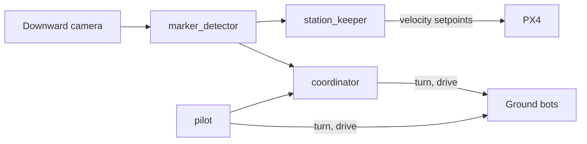
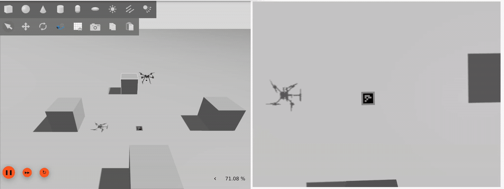
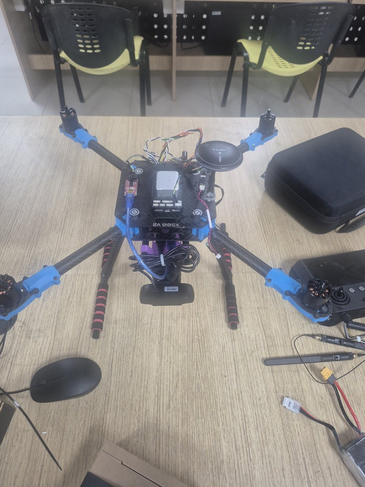
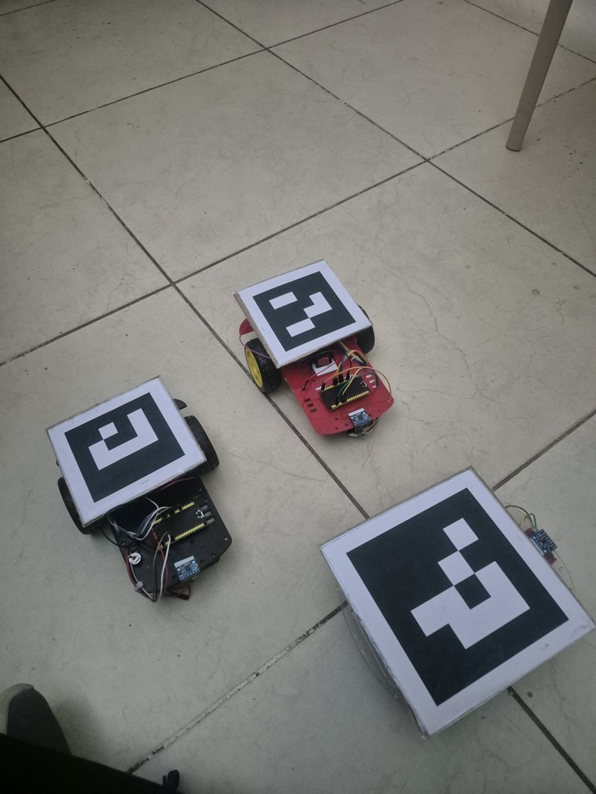

# corvid: Aerial-Guided Ground Swarm

A drone holds itself over a ground robot using only its downward camera, and the same image coordinates a swarm of low-cost ground robots below it. It runs indoors with no GPS: the drone holds position on optical flow and a rangefinder, and every robot is located by the ArUco tag it carries.

https://github.com/user-attachments/assets/05cf5ddd-dee4-4675-969b-2ef7dde6b0e4

The drone is in PX4 Offboard under the station keeper. The right half is its downward camera with the controller's state overlaid; when the marker is pushed across the floor with a pole, the drone follows it.

## How it works

`marker_detector` finds `DICT_4X4_50` tags in the downward camera and solves each tag's metric pose with `solvePnP`, resolving the planar pose ambiguity with a flat-ground prior. `station_keeper` turns the tag's offset into lateral velocity setpoints for PX4 and holds altitude with a position setpoint. PX4 keeps its own inner loops and failsafes, the setpoints go out on a fixed-rate timer so a slow camera frame never drops Offboard, and if the tag is lost the drone holds briefly and then lands.

The ground robots need no world frame. Every bot and the target appear in the same image at the same instant, so the goal relative to a bot is the difference of two poses from one picture, and the drone moving between frames changes nothing. `coordinator` measures a stopped bot, sends it a relative turn, streams a straight drive, stops it from the camera and measures again. `pilot` drives a bot by keyboard or runs a square search, then hands the bot over once the target is in view. Each bot is an ESP32 on micro-ROS over Wi-Fi with an L298N, two TT motors and an MPU6050; it executes turns and holds straight drives on its own gyro.

## Demos

**Simulation.** PX4 SITL and Gazebo, tracking a marker that moves in a cross.

**Marker-lost failsafe.** Offboard entered with no marker in view: the drone holds about 5 s, then lands.

https://github.com/user-attachments/assets/dbe912f1-cdb7-4db2-b667-2433e22069b1

**Coordinator driving a bot.** An overhead camera stands in for the drone. bot0 is turned toward its goal beside the target (red box) and driven there in measured legs.

https://github.com/user-attachments/assets/8779269d-c0ca-4189-b520-84d30481341d

## Results

| What | Result |
|---|---|
| Perception error against Gazebo ground truth | 1.40 cm median |
| Hold error in simulation, settled | 1.6 to 3.4 cm |
| Hold over a stationary marker, real drone | 13 to 16 cm median |
| Hold while the marker is pushed, real drone | 16 to 19 cm median, marker moved up to 0.78 m |
| Marker-lost hold then land, real drone | Works |

## Hardware

  
  

Holybro X500 V2 with a Pixhawk 6X v2 on PX4 v1.16.2, a Jetson Orin Nano over uXRCE-DDS, a CubePilot HereFlow for flow and range, and a Rapoo C200 downward camera. The bots are ESP32, L298N, MPU6050 and TT motors.

## Repository

| Path | What |
|---|---|
| `corvid_perception/` | `marker_detector` |
| `corvid_control/` | `station_keeper` |
| `corvid_swarm/` | `coordinator`, `pilot` |
| `corvid_msgs/` | Custom messages |
| `corvid_sim/` | `marker_mover` for Gazebo tracking tests |
| `firmware/bot_ros/` | Bot firmware (PlatformIO, micro-ROS) |
| `launch/`, `models/`, `config/` | Launch files, Gazebo marker models, camera calibrations |

Built on ROS 2 Humble in the [ROSCon 2025 PX4 workshop](https://github.com/Dronecode/roscon-25-workshop) image; the `Dockerfile` adds a patched `usb_cam` and the camera calibrator.
